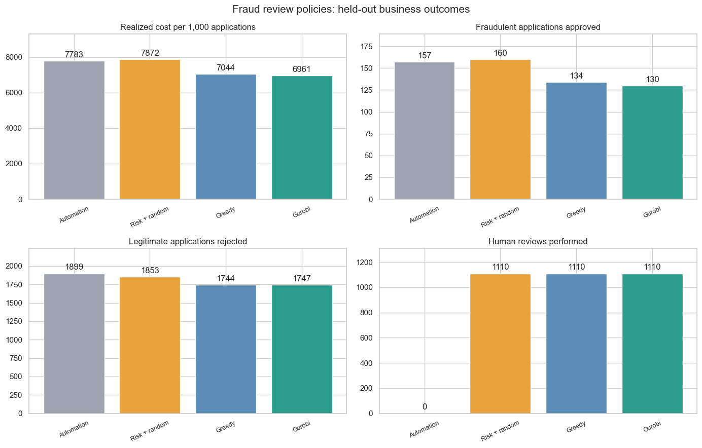
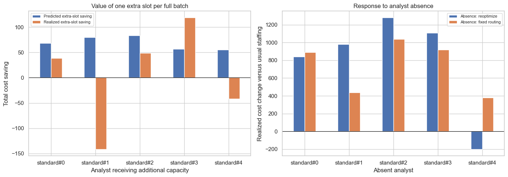

# OptiFraud: Reducing the cost of fraud review

## The problem

A fraud model can make two expensive mistakes: approving fraud and rejecting a legitimate application. Human review can help, but reviewers have limited time and also make mistakes.

This project asks which applications should be approved, rejected, or sent to a particular reviewer. There are five reviewers, each able to handle 10 cases per batch of 200.

I used machine learning to estimate fraud risk and the likely cost of each reviewer's mistakes. Gurobi then chose the assignments together, keeping each reviewer within their limit.

## The results

On 4,457 applications from the final month, total cost fell from **34,690 to 31,025 units**, a **10.57% reduction** compared with automated decisions alone.

The optimized assignments led to **27 fewer fraudulent approvals** and **152 fewer legitimate rejections**. They used 1,110 reviews, covering 24.9% of applications.

Reviewing the highest-risk cases with random reviewer assignment slightly increased cost. Greedy assignment, which takes the largest predicted saving one case at a time, performed much better. Joint optimization saved another **370 units, or 1.18%**, compared with greedy, using the same number of reviews.

## Where the savings came from

The project assumes a cost of 100 units for approving fraud, 10 for rejecting a legitimate application, and 0.5 for a review. Compared with automation:

- 27 fewer fraudulent approvals saved **2,700 units**.
- 152 fewer legitimate rejections saved **1,520 units**.
- 1,110 reviews added **555 units**.

That leaves a net saving of **3,665 units** after paying for review.

For a dollar example, suppose those costs were \$1,000, \$100, and \$5 instead. The same results would represent **\$36,650 in simulated savings**. These dollar amounts are illustrative; the test uses FiFAR's synthetic reviewers and assumed costs.

## Extra capacity and reviewer absences

We tested extra capacity for one reviewer at a time. Adding one slot per batch of 200 applications lowered actual cost in three of the five tests and increased it in two. In one case, the model predicted a saving of about 80 cost units, but actual cost increased by 141.5 units.

We also tested what happens when a reviewer is absent. Reassigning the work through optimization was cheaper in two of the five tests. In the other three, costs were lower when we kept the remaining reviewers’ assignments and automated the absent reviewer’s cases.

