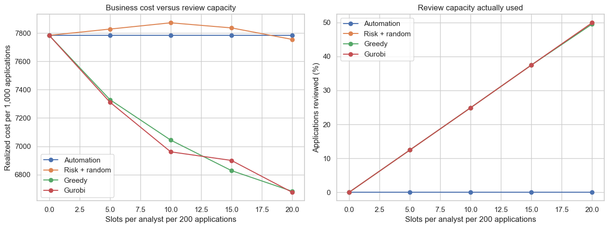
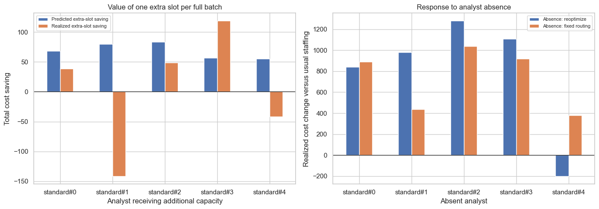

# OptiFraud: How the model works

The task is to choose between approving an application, rejecting it, and assigning it to one of five reviewers. The model minimizes estimated mistake and review costs while limiting each reviewer's workload.

## Data and training

The project uses 30,622 already flagged applications from FiFAR, with recorded decisions from five synthetic reviewers. A reviewer can approve or reject a case, and either decision can be wrong.

The data are split by month:

- **Training:** 20,765 applications from month codes 3–5. Used to fit the feature encoder and XGBoost models.
- **Calibration:** 2,700 applications from month 6. Used to adjust the fraud probabilities.
- **Validation:** The other 2,700 applications from month 6. Used to inspect predictions and try example assignments.
- **Test:** 4,457 applications from month 7. Used to compare policies and examine staffing changes.

Thirty input attributes become 51 features after one-hot encoding. The fraud label, month, existing model score, and reviewer decisions are excluded from the inputs. The encoder is fitted on training data only.

There is one XGBoost fraud classifier and one XGBoost cost regressor for each reviewer. All six models use 250 trees, depth 3, learning rate 0.05, minimum child weight 20, L2 regularization 5, and row and column sampling of 0.85. These settings are fixed in this version.

## From predictions to costs

The fraud classifier first produces a raw score $s_i$. A logistic regression fitted on the calibration set adjusts it:

$$
p_i=\frac{1}{1+e^{-(a s_i+b)}}.
$$

Here, $p_i$ is the estimated probability that application $i$ is fraudulent. Only $a$ and $b$ are fitted during calibration; the XGBoost model stays fixed.

For the reviewer models, the training target is the cost of each recorded decision:

$$
\ell_{ij}=100y_i(1-H_{ij})+10(1-y_i)H_{ij},
$$

where $y_i=1$ means actual fraud and $H_{ij}=1$ means reviewer $j$ rejected the application. A correct decision costs 0, approving fraud costs 100, and rejecting a legitimate application costs 10. Each regressor learns to predict this mistake cost from the application features.

The optimizer receives seven estimated costs per application:

$$
\begin{aligned}
\widehat c_{i,A}&=100p_i &&\text{approve},\\
\widehat c_{i,R}&=10(1-p_i) &&\text{reject},\\
\widehat c_{i,h_j}&=\widehat r_{ij}+0.5 &&\text{review by }j.
\end{aligned}
$$

The predicted reviewer mistake cost $\widehat r_{ij}$ is clipped to the range 0–100 before adding the review fee.

For example, if fraud probability is 0.20, approval costs 20 units and rejection costs 8. A reviewer with an estimated total cost of 3 would save 5 units compared with rejection. Whether that case gets the review slot also depends on the savings available on other cases.

With automation alone, the two costs are equal at $p=10/110\approx0.0909$. This is why the automatic decision boundary is much lower than 0.5.

## The optimization

Let $x_{ia}=1$ when application $i$ receives action $a$. The available actions are approval, rejection, and the five reviewers. For each batch, Gurobi solves:

$$
\begin{aligned}
\min_x\quad &\sum_i\sum_a\widehat c_{ia}x_{ia}\\
\text{subject to}\quad
&\sum_a x_{ia}=1 &&\text{for each application }i,\\
&\sum_i x_{i,h_j}\le b_j &&\text{for each reviewer }j,\\
&x_{ia}\in\{0,1\}.
\end{aligned}
$$

The first constraint gives each application one action. The second limits each reviewer's assignments. A full batch has 200 cases and 10 slots per reviewer. For a smaller batch of $n$ cases, each limit becomes $\lfloor10n/200\rfloor$.

Review is optional. The model can automate any application and does not impose a middle risk band that must receive human review. Gurobi solves each batch to optimality for the estimated costs.

## Results

The four policies were tested on the same final-month applications:

- **Automation:** Choose the cheaper automatic action. Total cost: **34,690**.
- **Risk + random:** Review the highest-risk cases and randomly allocate reviewer slots. Total cost: **35,085**.
- **Greedy:** Repeatedly take the case-reviewer assignment with the largest positive predicted saving. Total cost: **31,395**.
- **Gurobi:** Choose all assignments together. Total cost: **31,025**.

Actual outcomes are checked after assignments are made. For reviewed applications, the final decision comes from the assigned reviewer's recorded decision. Total cost is:

$$
C=100(\text{fraud approved})+10(\text{legitimate rejected})+0.5(\text{reviews}).
$$

Gurobi reduced fraudulent approvals from 157 to 130 and legitimate rejections from 1,899 to 1,747 compared with automation. After including review fees, the saving was **3,665 units, or 10.57%**. Compared with greedy, it saved **370 units, or 1.18%**, with four fewer fraudulent approvals and three more legitimate rejections.

All three review policies used 1,110 reviews. Each reviewer handled 222 cases across the test batches.

The fraud model's test ROC AUC was 0.7021 and average precision was 0.3358. Calibration slightly improved the Brier score from 0.1263 to 0.1251, while the ranking metrics stayed the same at the reported precision.

## What changes when capacity changes?

The capacity test varies the limit from 0 to 20 slots per reviewer. Gurobi's observed cost falls as more review slots become available in these tests. High-risk-first review gets much less benefit from the extra capacity.

At 15 slots, greedy has lower observed cost than Gurobi. The optimizer makes the best choices for its predicted costs, but those predictions can be wrong. In the main comparison, Gurobi predicted a total cost of 28,382.58; the actual cost was 31,025.

## Extra capacity and reviewer absences

The left panel adds one slot per full batch to one reviewer at a time. Across the test batches, this adds 23 available reviews. Positive savings mean lower cost. Two reviewers produced negative observed savings despite positive predicted savings. For reviewer standard#1, the predicted saving was 79.97 units, but observed cost increased by 141.5.

The right panel removes one reviewer. It compares assigning all cases again with keeping the other assignments and automating the absent reviewer's cases. Reassigning everything gave lower observed cost in two of the five absence scenarios. These experiments use the same test month; they do not establish which staffing choice would work best in a new month.

The reviewers are synthetic, costs are assumed, and the model has training feedback from every selected reviewer on every case. The findings come from one time split. Repeating the comparison across months and with actual reviewer feedback would give a better view of how stable the savings are.
